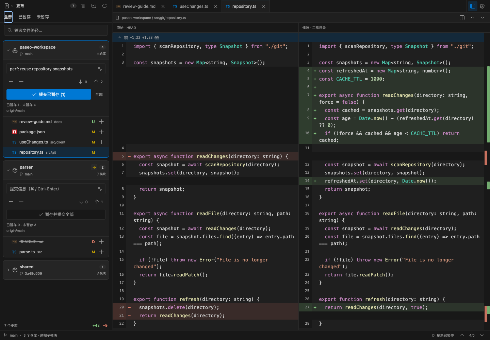
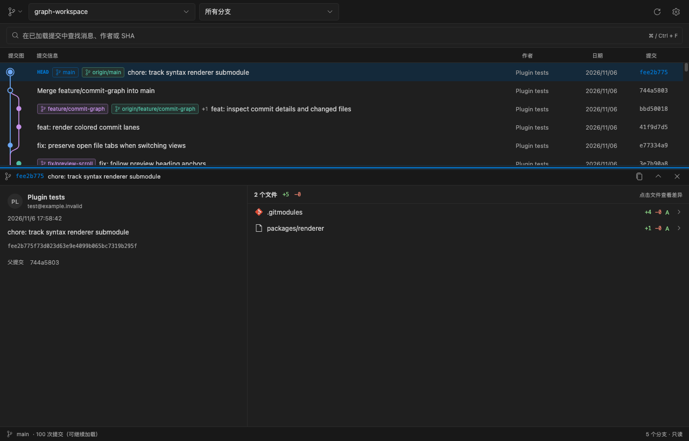
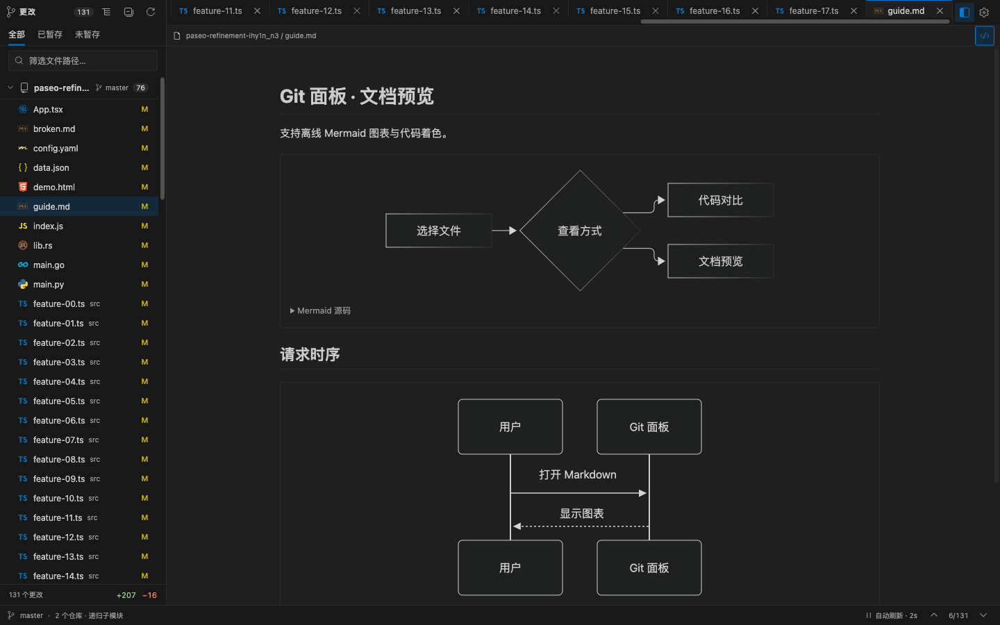

<p align="center">
  
</p>

<h1 align="center">GitLens</h1>

<p align="center"><strong>Review and commit across repositories, without leaving Paseo.</strong></p>

<p align="center">
  <a href="package.json"></a>
  <a href="paseo-plugin.json"></a>
</p>

<p align="center"><strong>English</strong> · <a href="README.zh-CN.md">简体中文</a></p>

<p align="center">
  <a href="#get-started">Get started</a> ·
  <a href="#review-changes-across-repositories">Review changes</a> ·
  <a href="#explore-commit-history">History</a> ·
  <a href="#preview-files">Previews</a> ·
  <a href="#develop-and-verify">Development</a>
</p>

- 🧩 **Nested repositories** — Review the root and initialized submodules, each against its own HEAD.
- 🔍 **Focused diffs** — Split or unified views, file tabs, change navigation, and stable refresh.
- ✍️ **Commit and sync** — Stage, draft messages, commit, pull, and push per repository.
- 🌿 **Trace history** — Follow branches and merges, inspect commits, and open historical diffs.
- 📖 **Preview documents** — Read Markdown, Mermaid, static HTML, and images alongside code.

## Get started

Requires **Paseo daemon and client 0.12.0+**, with Git installed on the daemon host.

```bash
paseo plugin install https://github.com/MinLeeV5/paseo-gitlens --ref main
```

Enable plugins in **Settings → Plugins** on the target daemon. Open a Git workspace, then click the **GitCompare** header icon to open GitLens. You can also select **GitLens · 包含 Submodule** in the Command Center (`⌘K` / `Ctrl+K`). The header entry may appear in the host's overflow menu.

## Review changes across repositories

Each repository uses its own HEAD, file list, and Git actions. GitLens discovers initialized submodules recursively, including those configured with `ignore = all`, while respecting standard file ignore rules.

| View     | Comparison                                                                    |
| -------- | ----------------------------------------------------------------------------- |
| All      | Each repository's HEAD → working tree, including staged and untracked changes |
| Staged   | HEAD → index                                                                  |
| Unstaged | Index → working tree, plus untracked files                                    |

- Switch between split and unified diffs, open multiple tabs, and filter by path.
- Jump between change blocks or click the red/green overview markers. Adjust context, whitespace, and wrapping.
- Keep the current diff and scroll position while refreshing. Unchanged cached tabs reopen without another read.
- See submodule HEAD drift separately from uncommitted changes. Review each submodule against its own HEAD.

_Screenshots use a local demo workspace._



## Commit and sync

Stage or unstage individual files with `+` / `−`, or use a repository's controls for all its files. The commit button uses staged changes when present; **Stage and commit all** explicitly includes that repository's remaining changes.

Generate an editable commit message with **Paseo AI** or **local file rules**. AI uses the selected repository and staged scope when available. Customize instructions in **Settings → Commit**, or leave them empty to use the repository's `paseo.json`:

```json
{
  "metadataGeneration": {
    "commitMessage": {
      "instructions": "Use Conventional Commits and explain the purpose of the change."
    }
  }
}
```

AI drafts send file paths, change metadata, diff excerpts, and instructions to the configured Paseo provider. Local rules run on the daemon host.

Pull and push are scoped to the selected repository. Pull uses fast-forward mode; push uses its upstream or sets one on the first push. Incoming/outgoing counts use locally known upstream refs; status refresh does not fetch.

Git runs on the **daemon host**, using its existing identity, authentication, remotes, and hooks. After committing a submodule, stage and commit its gitlink in the parent when ready.

## Explore commit history

Select **Commit graph** from the view menu to browse the root repository or a submodule.

- Follow branches, merges, HEAD, and tags; filter by ref or search loaded messages, authors, and SHAs.
- Inspect commit messages, parents, and changed files, then open historical split or unified diffs.
- Load history in pages of 100. History refresh reads local objects without fetching; historical diffs stay independent of working-tree changes.



## Preview files

Open Markdown, static HTML, and images beside your diffs. Markdown supports offline Mermaid diagrams and workspace file links, including unchanged files, submodules, and heading anchors. Staged previews read the index version.



HTML previews do not run scripts. Document previews do not load external or relative image resources. Rendered Mermaid and HTML previews are available on desktop/Web; native mobile shows Mermaid source.

## Configure your workspace

**Settings** groups appearance, code, comparison, behavior, and commit options. Adjust fonts, layout, refresh interval, and the default view; preferences are saved per Paseo host. [View settings](assets/settings.png).

The last **5 visited tabs** retain their contents and scroll positions by default; configure 1–10. Automatic refresh defaults to 2 seconds after a scan, pauses in the background, and can be disabled. Narrow panels use separate list and diff pages.

| Shortcut                        | Action                                              |
| ------------------------------- | --------------------------------------------------- |
| `⌘/Ctrl+F`                      | Focus file filtering or history search              |
| `F7` / `Shift+F7`               | Next / previous change block                        |
| `Ctrl+PageUp` / `Ctrl+PageDown` | Previous / next file tab                            |
| `⌘/Ctrl+Enter`                  | Commit from the message field                       |
| `Esc`                           | Clear filtering or return from a narrow-screen diff |

## Scope and limits

- Supports linked worktrees, renames, deletions, conflicts, mode changes, and binary-file status. Uninitialized submodules are listed but not initialized automatically.
- Files and previews are limited to **1 MiB**; patches to **2 MiB**. Larger entries keep their status and explain the limit.
- Merge diffs use the first parent; root commits use the empty tree. Missing shallow-clone parents are reported explicitly.
- Branch switching, discarding changes, and comparisons between arbitrary refs are not provided.

## Develop and verify

Requires **Node.js 20.19+**. Runtime assets are bundled; development dependencies are needed only when working on the source.

```bash
git clone https://github.com/MinLeeV5/paseo-gitlens.git
cd paseo-gitlens
npm ci
npm run check
paseo plugin install "$PWD"
```

After editing, run `npm run check` and `paseo plugin reload paseo-gitlens`. To preview the real UI against a local Git repository:

```bash
PASEO_DIFF_ACCEPTANCE_DIRECTORY=/absolute/path/to/repo npm run dev:ui
```

Open `http://127.0.0.1:4178`; add `?theme=light` to check the light theme.

| Command                                     | Purpose                                                                |
| ------------------------------------------- | ---------------------------------------------------------------------- |
| `npm run check`                             | Version consistency, TypeScript, formatting, lint, and tests           |
| `npm run check:compatibility`               | Type checks against Paseo SDK 0.12–0.15                                |
| `npm run acceptance -- /path/to/repo`       | Compare repository results with native Git                             |
| `npm run verify:installed -- /path/to/repo` | Verify the installed plugin over real RPC                              |
| `npm run benchmark:regression`              | Compare frozen sources in an isolated daemon; fail on regression flags |

The regression benchmark requires a separate runtime. See [setup, measurements, and thresholds](docs/benchmarks/2026-11-12-optimization.md). More detail: [verification records](docs/verification.md), [VS Code comparison](docs/vscode-gap-analysis.md), and [third-party notices](docs/third-party-notices.md).
