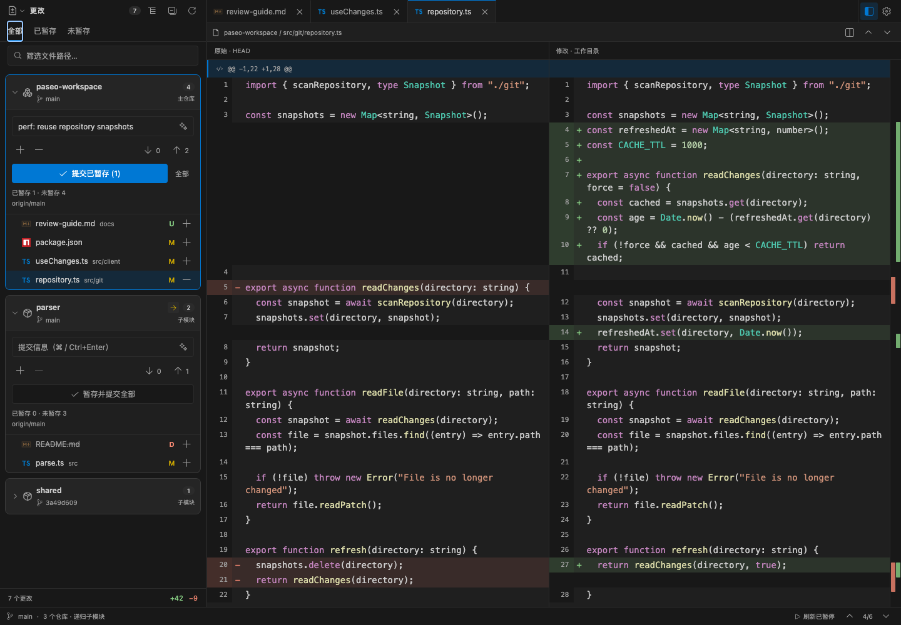
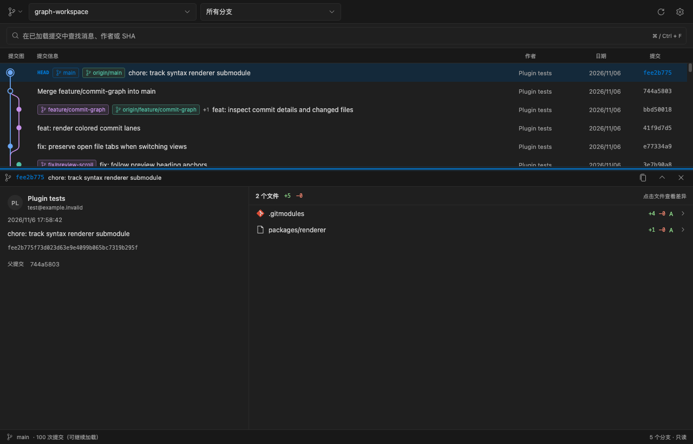
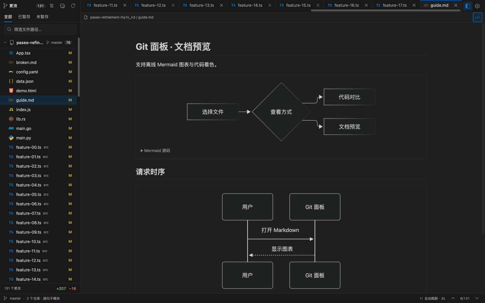

<p align="center">
  
</p>

<h1 align="center">GitLens</h1>

<p align="center"><strong>在 Paseo 中审阅多仓库变更，提交代码并追溯历史。</strong></p>

<p align="center">
  <a href="package.json"></a>
  <a href="paseo-plugin.json"></a>
</p>

<p align="center"><a href="README.md">English</a> · <strong>简体中文</strong></p>

<p align="center">
  <a href="#快速开始">快速开始</a> ·
  <a href="#审阅多仓库变更">审阅变更</a> ·
  <a href="#浏览提交历史">提交历史</a> ·
  <a href="#预览文件">文件预览</a> ·
  <a href="#开发与验证">开发指南</a>
</p>

- 🧩 **多层子模块** — 递归审阅主仓与已初始化子模块，各自对照自身 HEAD。
- 🔍 **专注审阅** — 左右 / 统一 diff、多文件标签、差异导航与稳定刷新。
- ✍️ **提交同步** — 逐仓暂存、生成提交信息、提交、拉取与推送。
- 🌿 **追溯历史** — 浏览分支与合并，检查提交详情和历史 diff。
- 📖 **文档预览** — 在代码旁查看 Markdown、Mermaid、静态 HTML 和图片。

## 快速开始

要求 **Paseo daemon 和客户端均为 0.12.0+**，daemon 主机已安装 Git。

```bash
paseo plugin install https://github.com/MinLeeV5/paseo-gitlens --ref main
```

在目标 daemon 的 **Settings → Plugins** 中启用插件。进入 Git 工作区，点击顶部 **GitCompare** 图标打开 GitLens；也可在 Command Center（`⌘K` / `Ctrl+K`）选择 **GitLens · 包含 Submodule**。顶部入口可能收在宿主的「更多操作」中。

## 审阅多仓库变更

各仓库使用自身 HEAD，分组显示文件并提供独立 Git 操作。GitLens 递归发现已初始化的子模块，即使配置了 `ignore = all`；文件仍遵守标准 Git ignore 规则。

| 视图   | 比较范围                                     |
| ------ | -------------------------------------------- |
| 全部   | 各仓库 HEAD → 工作目录，包含暂存和未跟踪变更 |
| 已暂存 | HEAD → 暂存区                                |
| 未暂存 | 暂存区 → 工作目录，并显示未跟踪文件          |

- 切换左右或统一对比，用多文件标签和路径筛选完成审阅。
- 跳转差异块，或点击红绿概览标记定位改动；可调整上下文、空白和换行。
- 刷新时保留当前 diff 与滚动位置；切回未变化的缓存标签无需重新读取。
- 子模块 HEAD 与父仓 gitlink 的差异单独显示，各子模块始终与自身 HEAD 比较。

_截图使用本地示例工作区。_



## 提交与同步

文件行的 `+` / `−` 可暂存或取消暂存单个文件，仓库按钮可批量操作。有已暂存变更时，提交按钮只提交暂存区；「暂存并提交全部」明确包含该仓库其余变更。

使用 **Paseo AI** 或**本地文件规则**生成可编辑的提交信息。AI 按所选仓库生成，有暂存变更时使用暂存范围。在**设置 → 提交**中定制提示词；留空时使用该仓库的 `paseo.json`：

```json
{
  "metadataGeneration": {
    "commitMessage": {
      "instructions": "使用中文和 Conventional Commits，说明变更目的。"
    }
  }
}
```

AI 生成会将文件路径、变更信息、diff 片段与提示词发送给已配置的 Paseo 模型提供商；本地规则在 daemon 主机执行。

拉取和推送只作用于所属仓库。拉取使用快进模式，推送沿用上游或在首次推送时设置上游。箭头旁的提交数来自本地已有的上游引用，刷新状态不会执行 fetch。

Git 在 **daemon 主机**执行，使用其现有身份、认证、远程配置和钩子。子模块提交后，可再到父仓暂存并提交 gitlink。

## 浏览提交历史

从视图菜单切换到**提交图**，选择主仓或任一子模块。

- 查看分支、合并、HEAD 和标签；按引用筛选，或搜索已加载的消息、作者与 SHA。
- 检查提交消息、父提交和文件列表，再打开历史左右或统一 diff。
- 每页加载 100 条历史。手动刷新只读本地 Git 对象；历史 diff 不受当前工作目录变更影响。



## 预览文件

在 diff 旁预览 Markdown、静态 HTML 和图片。Markdown 支持离线 Mermaid、工作区文件链接及标题锚点，可打开未修改文件和跨子模块文件；已暂存视图读取真实暂存区版本。



HTML 预览不运行脚本，文档预览不加载外部或相对图片资源。HTML 和 Mermaid 图形面向桌面 / Web；原生移动端显示 Mermaid 源码。

## 按习惯配置

**设置**分为外观、代码、比较、行为和提交。可调整字体、布局、刷新间隔和默认视图，偏好按 Paseo 主机保存。[查看设置截图](assets/settings.png)。

界面语言可在**外观设置**中切换**英文 / 简体中文**，提交信息生成会跟随所选语言。

默认保留最近 **5 个标签**的内容和滚动位置，可设置为 1–10 个。自动刷新默认在扫描结束 2 秒后执行，可暂停，进入后台时停止。窄屏使用独立列表页与 diff 页。

| 快捷键                          | 操作                             |
| ------------------------------- | -------------------------------- |
| `⌘/Ctrl+F`                      | 定位文件筛选或历史搜索           |
| `F7` / `Shift+F7`               | 下一个 / 上一个差异块            |
| `Ctrl+PageUp` / `Ctrl+PageDown` | 上一个 / 下一个文件标签          |
| `⌘/Ctrl+Enter`                  | 在提交框内提交                   |
| `Esc`                           | 清除筛选，或从窄屏 diff 返回列表 |

## 支持范围与限制

- 支持 linked worktree、重命名、删除、冲突、权限变更和二进制状态；未初始化的子模块只显示状态。
- 文件与预览上限为 **1 MiB**，补丁上限为 **2 MiB**；超限文件保留状态并说明限制。
- 合并提交比较第一父提交，初始提交比较空树；浅克隆缺少父提交时会明确提示。
- 暂不提供分支切换、丢弃更改或任意两个 ref 之间的比较。

## 开发与验证

要求 **Node.js 20.19+**。运行资源已随插件打包，仅开发源码时需要安装依赖。

```bash
git clone https://github.com/MinLeeV5/paseo-gitlens.git
cd paseo-gitlens
npm ci
npm run check
paseo plugin install "$PWD"
```

修改后运行 `npm run check`，再执行 `paseo plugin reload paseo-gitlens`。用本地 Git 仓库预览真实界面：

```bash
PASEO_DIFF_ACCEPTANCE_DIRECTORY=/absolute/path/to/repo npm run dev:ui
```

浏览器打开 `http://127.0.0.1:4178`，添加 `?theme=light` 可检查浅色主题。

| 命令                                        | 用途                                             |
| ------------------------------------------- | ------------------------------------------------ |
| `npm run check`                             | 检查版本一致性、TypeScript、格式、lint 和测试    |
| `npm run check:compatibility`               | 对 Paseo SDK 0.12–0.15 执行类型检查              |
| `npm run acceptance -- /path/to/repo`       | 与原生 Git 对照仓库结果                          |
| `npm run verify:installed -- /path/to/repo` | 通过真实 RPC 验证已安装插件                      |
| `npm run benchmark:regression`              | 在隔离 daemon 中对测固定源码，出现回退标记时失败 |

性能对测需另行准备 runtime，见[安装方法、实测数据与门槛](docs/benchmarks/2026-11-12-optimization.md)。更多资料：[验证记录](docs/verification.md)、[VS Code 对照](docs/vscode-gap-analysis.md)、[第三方资源](docs/third-party-notices.md)。
